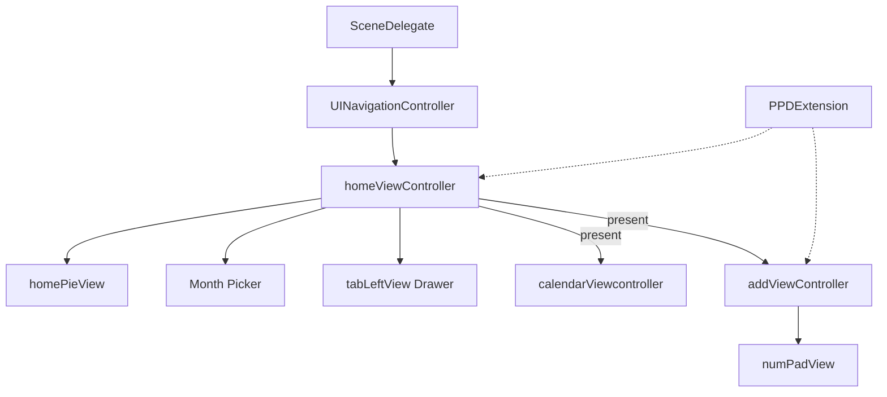

Last updated: 2026-10-25

> [!NOTE]
> This README was generated by [SKILL](https://github.com/agenvoy/skill-readme-generate), get the ZH version from [here](./doc/README.zh.md).

---

<strong>BUILD A WHOLE UIKIT BOOKKEEPING APP IN CHAINS!</strong>

---

> A Swift UIKit bookkeeping app demo with chainable view extensions, animated expense pie chart, and calculator-style entry keypad

## Table of Contents

- [Features](#features)
- [Architecture](#architecture)
- [License](#license)
- [Author](#author)

## Features

> `git clone https://github.com/pardnchiu/demo-swift-moneybook.git` · [Documentation](./doc/doc.md)

- **Chainable UIKit Extensions** — The bundled PPDExtension makes every setter and Auto Layout constraint return self, so each screen is built in pure code from chained calls without Storyboard layouts.
- **Animated Percentage Pie** — Two masked half-discs rotate in sequence with UIViewPropertyAnimator to draw a percentage, with no Core Graphics drawing or third-party chart library.
- **Drop-down Month Picker** — Tapping the navigation title slides in a blurred panel with a 12-month grid and a year switcher while the arrow icon rotates.
- **Self-laying Monthly Calendar** — The calendar computes its grid from the first weekday, the previous month's tail, and full-week padding at runtime, and highlights today.
- **Calculator-style Entry** — Income categories appear as an SF Symbols grid above a keypad with a date switcher, a description field, and arithmetic keys.

## Architecture

> [Full Architecture](./doc/architecture.md)

## License

This project is licensed under the [GPL-3.0 LICENSE](LICENSE).

## Author

Just [open an issue](https://github.com/pardnchiu/demo-swift-moneybook/issues/new) to share an idea.

---

©️ 2023 [邱敬幃 Pardn Chiu](https://www.linkedin.com/in/pardnchiu)
