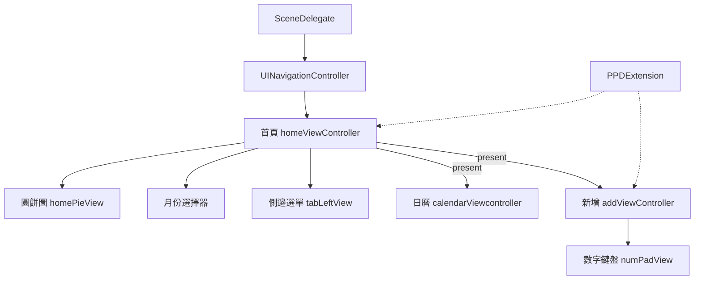

最後更新：2026-10-25

> [!NOTE]
> 此 README 由 [SKILL](https://github.com/agenvoy/skill-readme-generate) 生成，英文版請參閱 [這裡](../README.md)。

---

<strong>BUILD A WHOLE UIKIT BOOKKEEPING APP IN CHAINS!</strong>

---

> Swift UIKit 記帳 App 範例，具備鏈式 View 擴充、動畫支出圓餅圖與計算機式輸入鍵盤

## 目錄

- [功能特點](#功能特點)
- [架構](#架構)
- [授權](#授權)
- [Author](#author)

## 功能特點

> `git clone https://github.com/pardnchiu/demo-swift-moneybook.git` · [完整文件](./doc.zh.md)

- **鏈式 UIKit 擴充** — 內建的 PPDExtension 讓每個 setter 與 Auto Layout 約束都回傳自身，整個畫面不靠 Storyboard、以一條條鏈式呼叫純程式碼組成。
- **動畫比例圓餅圖** — 以兩個半圓遮罩搭配 UIViewPropertyAnimator 依序旋轉畫出百分比，不需 Core Graphics 繪圖或第三方圖表套件。
- **下拉月份選擇器** — 點擊導覽列標題即展開毛玻璃面板，提供 12 個月份網格與前後年切換，箭頭同步旋轉。
- **自動排版當月日曆** — 依當月首日星期、上月月底與補滿整週的規則即時算出日期格，並標示今天。
- **計算機式記帳輸入** — 收入分類以 SF Symbols 網格呈現，搭配含日期切換、描述欄與四則運算鍵的數字鍵盤。

## 架構

> [完整架構](./architecture.zh.md)

## 授權

本專案採用 [GPL-3.0 LICENSE](../LICENSE)。

## Author

Just [open an issue](https://github.com/pardnchiu/demo-swift-moneybook/issues/new) to share an idea.

---

©️ 2023 [邱敬幃 Pardn Chiu](https://www.linkedin.com/in/pardnchiu)
