# demo-swift-moneybook - Architecture

Last updated: 2026-10-25

> Back to [README](../README.md)

## Overview

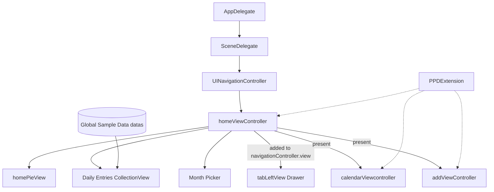

## Module: Launch

`AppDelegate` returns the default scene configuration, and `SceneDelegate` builds the window and navigation stack in code.

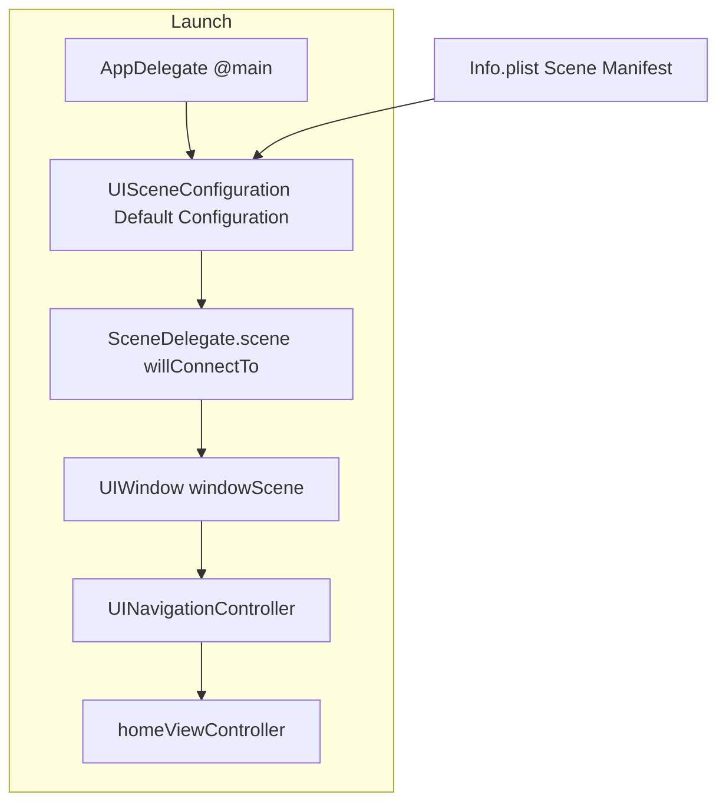

## Module: homeViewController

The home screen consists of a scroll container, a blurred month picker, and a bottom add button.

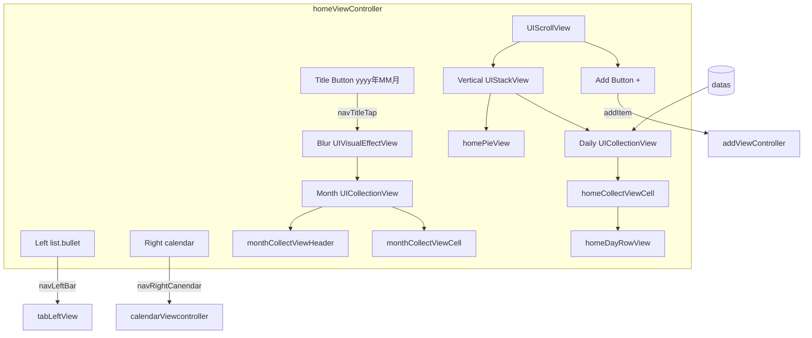

## Module: homePieView

Two clipped half-disc views rotate together to form the percentage.

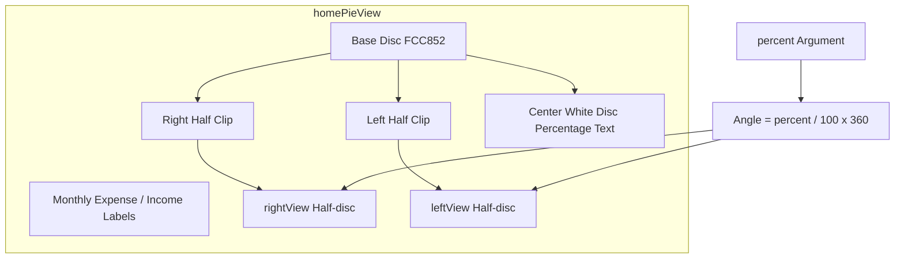

## Module: calendarViewcontroller

The calendar grid is generated from the current month at runtime, with an entry table below.

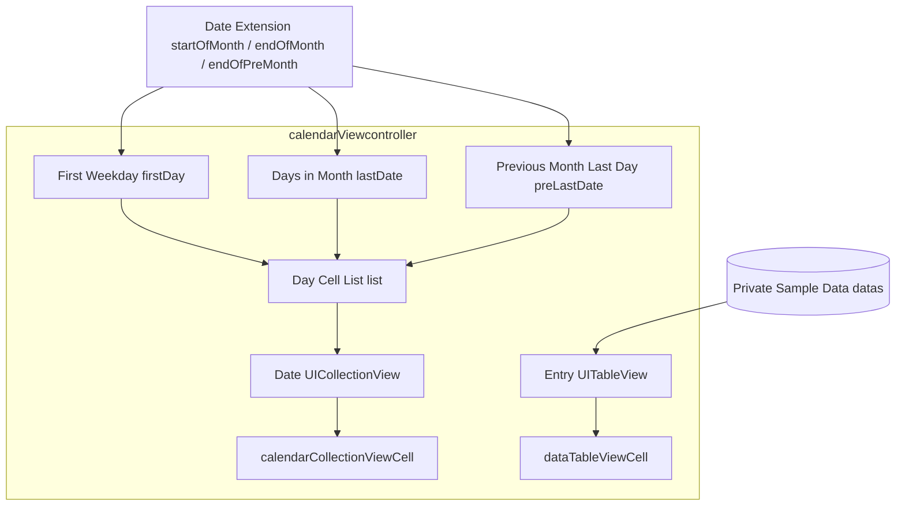

## Module: addViewController

An income / expense segmented control sits on top, the category grid in the middle, and the keypad at the bottom.

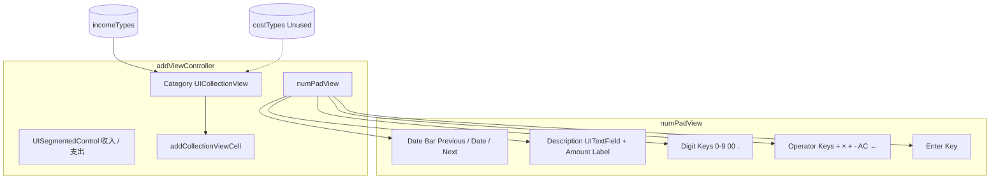

## Module: tabLeftView

An overlay added to `navigationController.view`, 70% of the screen width.

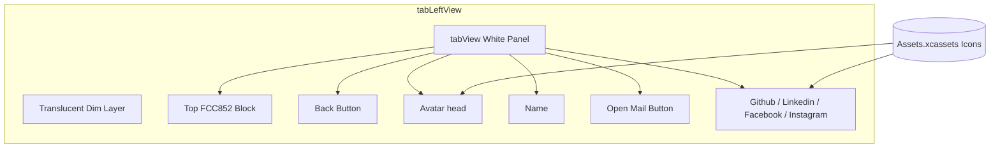

## Module: PPDExtension

A set of self-returning UIKit extensions that every screen is chained from.

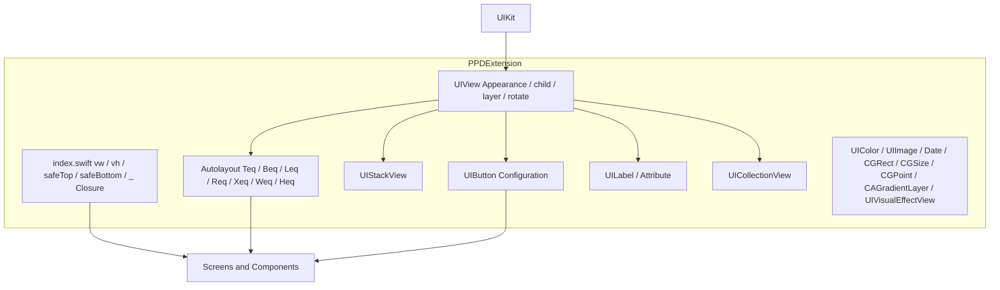

## Data Flow

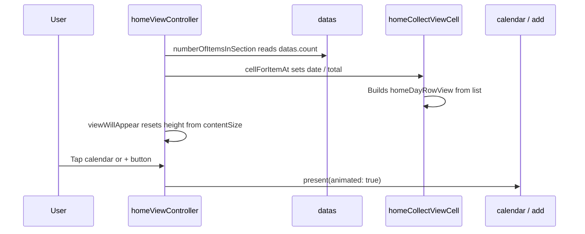

## State Machine

### Month Picker

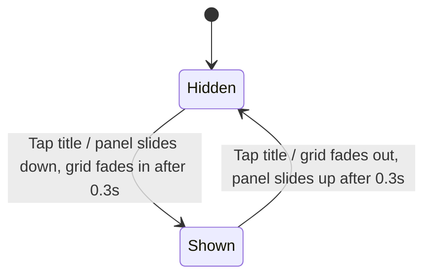

### Drawer

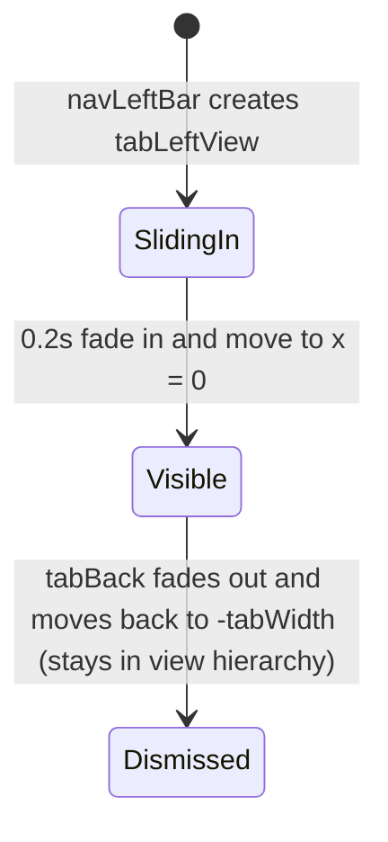

***

©️ 2023 [邱敬幃 Pardn Chiu](https://www.linkedin.com/in/pardnchiu)
