# demo-swift-moneybook - 架構

最後更新：2026-10-25

> 返回 [README](./README.zh.md)

## 概覽

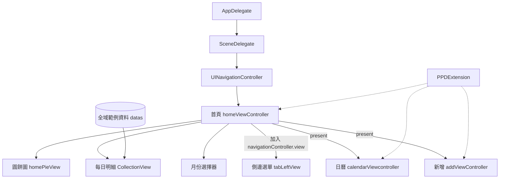

## Module: 啟動流程

`AppDelegate` 回傳預設場景設定，`SceneDelegate` 以純程式碼建立視窗與導覽堆疊。

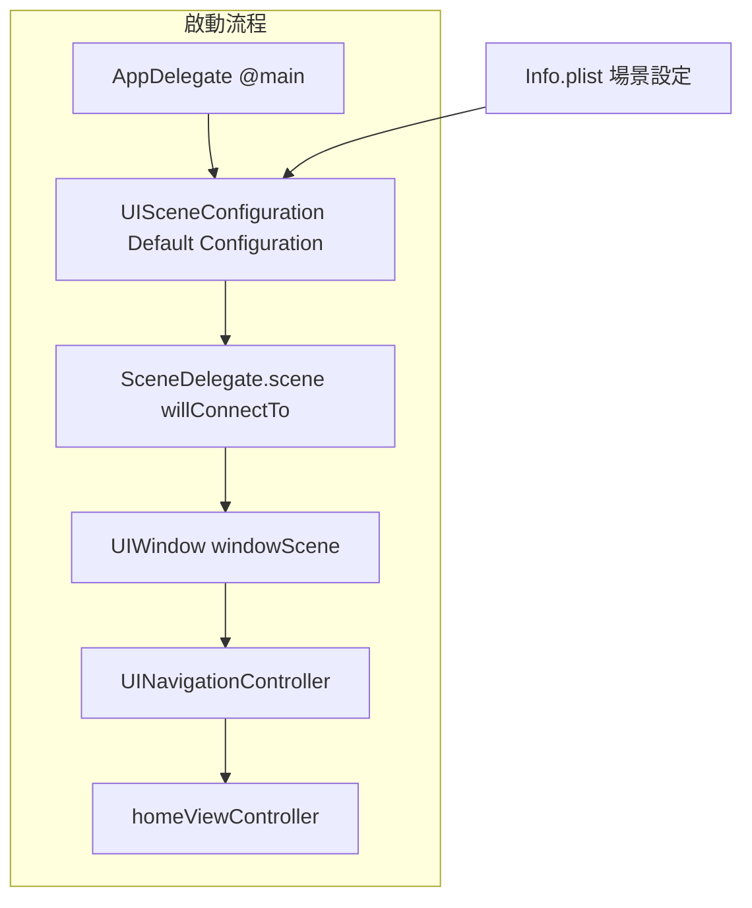

## Module: 首頁 homeViewController

首頁由捲動容器、毛玻璃月份選擇器與底部新增按鈕組成。

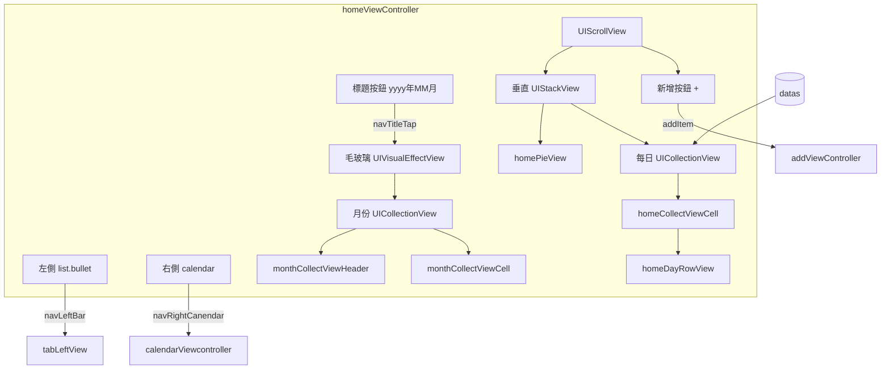

## Module: 圓餅圖 homePieView

以兩個裁切的半圓視圖旋轉組合出百分比。

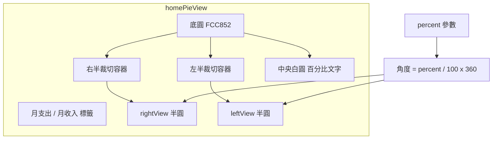

## Module: 日曆 calendarViewcontroller

依當月日期即時產生日曆格，下方以表格呈現明細。

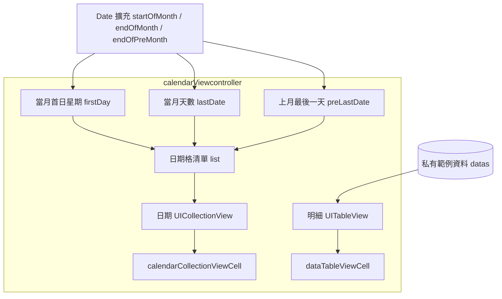

## Module: 新增 addViewController

上方為收入／支出分段控制，中間為分類網格，下方為數字鍵盤。

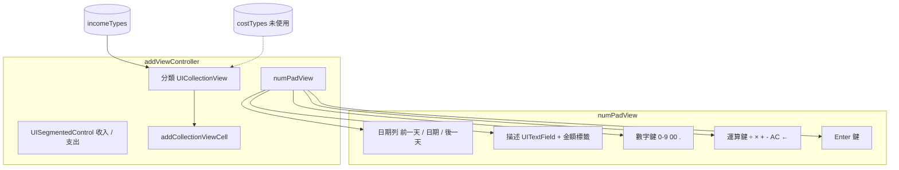

## Module: 側邊選單 tabLeftView

加在 `navigationController.view` 上的覆蓋層，寬度為螢幕 70%。

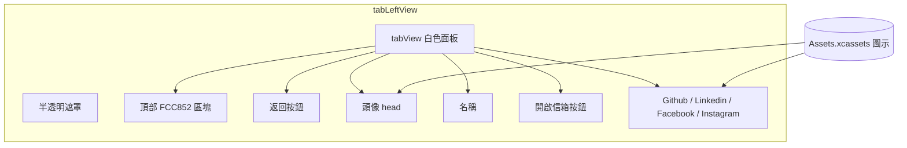

## Module: PPDExtension

一組回傳自身的 UIKit 擴充，所有畫面都以此鏈式組成。

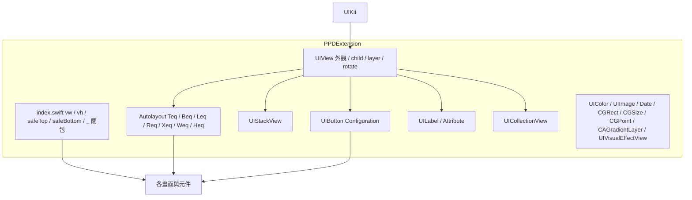

## 資料流

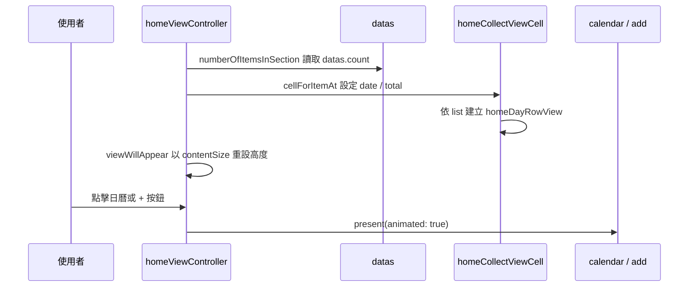

## 狀態機

### 月份選擇器

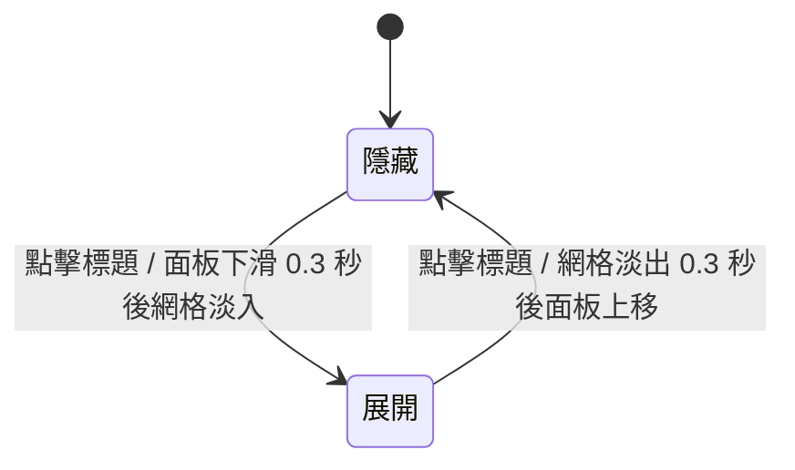

### 側邊選單

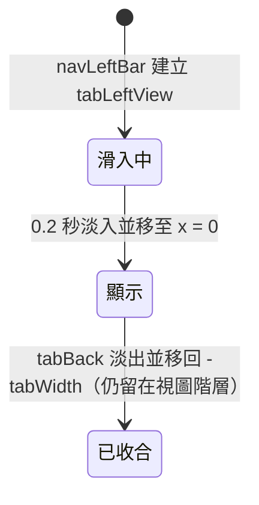

***

©️ 2023 [邱敬幃 Pardn Chiu](https://www.linkedin.com/in/pardnchiu)
